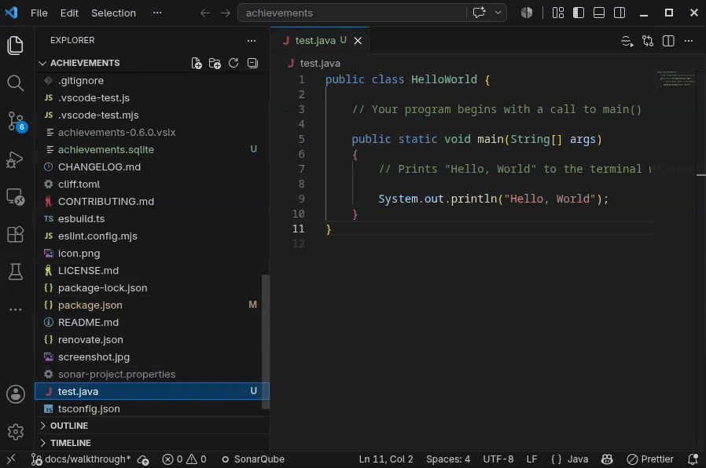

# Achievements

Achievements is a Visual Studio Code extension that allows you to track your progress in coding, and earn achievements for completing tasks.

> [!WARNING]
> This extension is in beta, may contain bugs and database schema may change in future versions.
> It is recommended to back up your data before updating.

## Features

- Track your progress in coding
- Earn achievements for completing tasks
- View your achievements in the **Achievements** panel
- View each achievement's description and requirements
- View your progress towards each achievement
- Track your time spent coding
- Filter achievements by category, progress, and name
- View your profile and completion percentage
- Enable or disable notifications
- Enable or disable any type of listeners for **privacy**

## Documentation

📖 **<https://boxboxjason.github.io/achievements/>**

The documentation covers [installation](https://boxboxjason.github.io/achievements/docs/installation/), [getting started](https://boxboxjason.github.io/achievements/docs/getting-started/), [how it works](https://boxboxjason.github.io/achievements/docs/how-it-works/) (local data, devcontainers, network access), the full list of [achievements](https://boxboxjason.github.io/achievements/docs/achievements/), [commands](https://boxboxjason.github.io/achievements/docs/commands/) and [settings](https://boxboxjason.github.io/achievements/docs/settings/).

## Privacy

Progress is stored locally in a SQLite database, and by default this extension makes **no network requests**. The only exception is the opt-in `achievements.checkOutdatedExtensions` setting, which sends the IDs of your installed extensions to the VS Marketplace to check for outdated versions. Every listener can be turned off individually in the settings.

## Installation

Install it from [Open VSX](https://open-vsx.org/extension/boxboxjason/achievements), or download the VSIX from the [GitHub releases](https://github.com/boxboxjason/achievements/releases) and run **Extensions: Install from VSIX...**. Then run **Achievements: Show** from the Command Palette (`Ctrl+Shift+P`).

## Development

See [CONTRIBUTING.md](CONTRIBUTING.md) to build, test and package the extension, and to work on the documentation.
